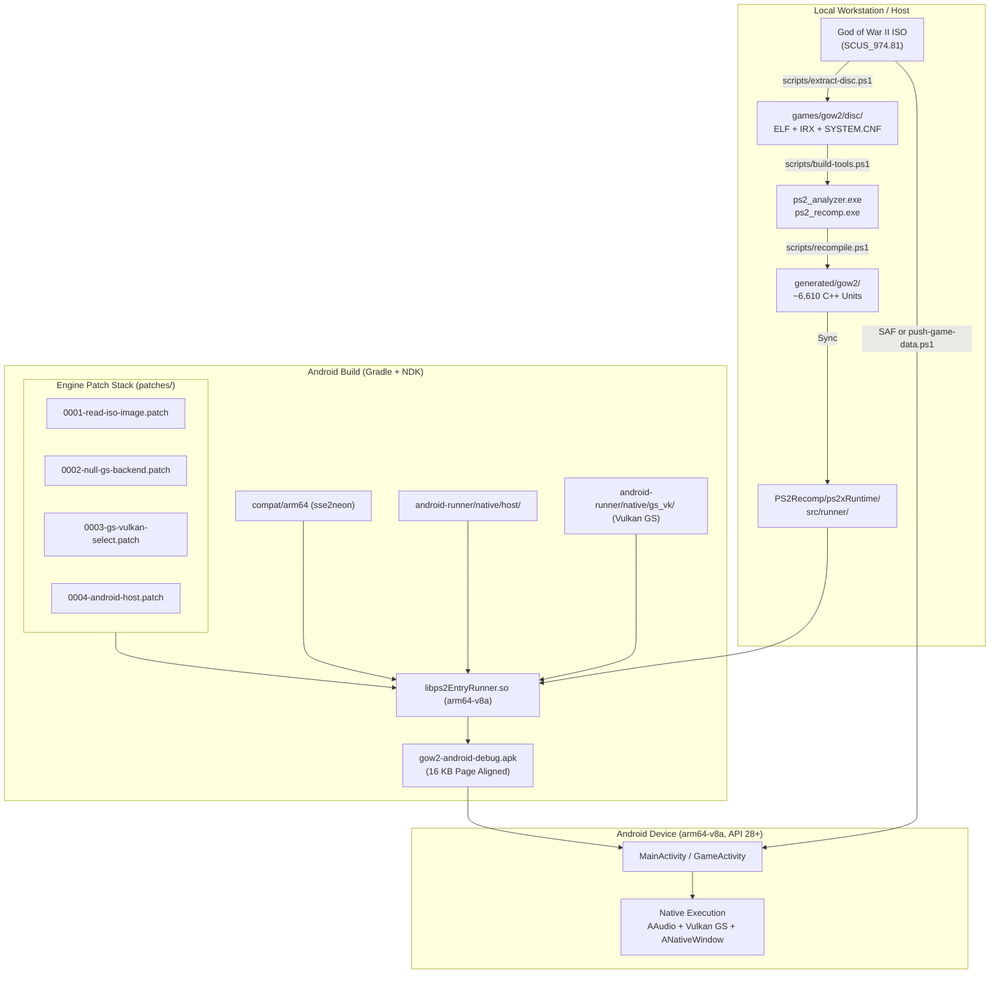

# AGENTS.md — God of War II Android arm64 Build Kit

This document provides operational context, architectural reference, workflows, and strict development rules for AI agents and human contributors working within this repository.

---

## 1. Project Overview & Mission

This repository is a **build kit** that ports **God of War II** (PlayStation 2, USA `SCUS_974.81` v1.01) to **native Android arm64 (AArch64)** using **Static Recompilation (AOT translation)**:

* **No General Emulator**: The game code does not run inside an emulator frontend (like AetherSX2/PCSX2). The Emotion Engine (EE) MIPS binary is translated ahead-of-time into ~6.6k C++ compilation units.
* **Vulkan GS Backend**: PS2 Graphics Synthesizer (GS) draw calls and state are mapped directly to a raw Vulkan 1.1 renderer (`GSVkBackend`).
* **Native Android Host**: Managed Android app (`MainActivity` + `GameActivity`) with native JNI bridge (`ps2x_host`), AAudio for low-latency audio, native touch/controller input, and `ANativeWindow` presentation.
* **Strict Legal Separation**: **Zero proprietary or copyrighted game code/assets are committed.** No ISOs, no ELFs, no IRX modules, no generated C++, and no APKs live in version control. Everything derived from the disc is generated and kept locally on the user's workstation.

---

## 2. Repository Layout

```
gow2-android-build-kit/
├── android-runner/              # Android Gradle project (Java + C++ host runtime)
│   ├── app/                     # Android application module (manifest, launcher, UI)
│   └── native/                  # C++ native runtime and host implementation
│       ├── gs_vk/               # Raw Vulkan 1.1 Graphics Synthesizer backend (M2)
│       │   ├── shaders/         # GLSL shaders (draw, shuffle, present) -> SPIR-V
│       │   ├── gs_vk_backend.*  # Vulkan backend implementing GSRasterBackend
│       │   └── gs_vk_loader.*   # Dynamic loader for Vulkan (dlopen libvulkan.so)
│       ├── host/                # Android host layer (ANativeWindow, AAudio, input, logs)
│       └── iso/                 # In-app ISO9660 reader and SHA1 ELF extractor
├── compat/                      # Cross-platform compatibility shims
│   └── arm64/                   # x86 SIMD header shims (immintrin.h) over sse2neon
├── config/                      # Recompiler configuration (funcmap.csv, recomp.template.toml)
├── docs/                        # Project documentation (ANDROID.md, NOTES-REFERENCE.md)
├── overrides/                   # C++ custom function overrides for GoW II (gow2_overrides.cpp)
├── patches/                     # Stack of ordered git patches applied to PS2Recomp (0001–0004)
├── PS2Recomp/                   # Git submodule: PS2Recomp engine (branch godofwar2 @ 379fa48)
├── scripts/                     # PowerShell automation scripts for setup, build, and testing
├── tests/                       # Unit and offscreen integration tests
│   └── gs_probe/                # Offscreen Vulkan GS test harness (SwiftShader / ICD)
├── tools/                       # Python & C++ utilities (ISO/ELF extraction, IRX analysis, funcmap)
├── TASKS.md                     # Roadmap, milestones, and active task tracking
├── VERIFICATION.md              # Test logs, verification gates, and evidence record
└── README.md                    # Primary user-facing documentation
```

### Gitignored Output Directories
* `build/` — Intermediate CMake files, logs, and effective configuration.
* `dist/` — Final built APKs (`gow2-android-debug.apk`, `gow2-android-release.apk`).
* `games/` — Extracted disc files (`SCUS_974.81`, `SYSTEM.CNF`, `*.IRX`).
* `generated/` — Output of `ps2_recomp` (~6.6k generated `.cpp` files).
* `PS2Recomp/ps2xRuntime/src/runner/` — Recompiled game sources synced into the engine runner.

---

## 3. Core Architecture & Pipeline



### The 4 Kit Patches (Source of Truth)
Engine modifications are stored as `-p1` unified diffs in `patches/` and applied sequentially to `PS2Recomp`:
1. `patches/0001-read-iso-image.patch`: Enables reading disc contents directly from ISO image files via `GOW2_ISO` environment variable or sibling `gow2.iso`.
2. `patches/0002-null-gs-backend.patch`: Adds `PS2X_FORCE_NULL_GS` support for headless/boot testing without graphics rendering.
3. `patches/0003-gs-vulkan-select.patch`: Hooks `GSVkBackend` (`GSThreadedBackend(std::make_unique<GSVkBackend>())`) when `PS2X_ANDROID_VULKAN_GS` is active.
4. `patches/0004-android-host.patch`: Android platform integration: routes window presentation, AAudio, input pad, logging, and exposes the entry point `ps2x_android_game_main()`.

---

## 4. Development Environment & Prerequisites

* **Host Operating System**: Windows 10/11 x64.
* **Build Systems & Compilers**:
  * **Visual Studio 2022 or 2026** with **Desktop development with C++** workload (MSVC for host tools).
  * **CMake 3.24+** (Host CMake) & **CMake 3.31.5** (Android SDK CMake).
  * **Python 3.10+** (with standard library, used for extraction and analysis scripts).
  * **Git** (configured with LF line-endings awareness).
* **Android Toolchain**:
  * **JDK 17** (`java` on `PATH` or `JAVA_HOME`).
  * **Android SDK**: `platform-tools`, `platforms;android-35`, `build-tools;34.0.0+`.
  * **Android NDK**: `27.3.13750724` (pinned in `android-runner/app/build.gradle`).
  * `shader-tools` component in NDK (provides `glslc` for compiling Vulkan GLSL shaders).
* **Target Hardware (for on-device testing)**:
  * Android 9+ (API 28+), `arm64-v8a`.
  * Vulkan 1.1+ GPU driver.
  * Support for **16 KB memory page size** (Android 15+ readiness).

---

## 5. Standard Scripts & Build Workflows

All commands are run using PowerShell from the repository root:

| Command | Purpose | Key Parameters |
|---|---|---|
| `.\scripts\setup.ps1` | Initializes `PS2Recomp` submodule and applies patches `0001`–`0004`. | None |
| `.\scripts\build-tools.ps1` | Compiles MSVC tools (`ps2_analyzer.exe`, `ps2_recomp.exe`). | None |
| `.\scripts\extract-disc.ps1` | Extracts boot ELF (`SCUS_974.81`), `SYSTEM.CNF`, and IOP `*.IRX` from ISO. | `-Iso "<path_to_iso>"` |
| `.\scripts\recompile.ps1` | Runs `ps2_recomp` to translate ELF into C++ units and syncs to runner. | None |
| `.\scripts\build-android.ps1` | Builds Android APK (`dist/gow2-android-*.apk`). | `-Configuration Debug\|Release`<br>`-NullGs:$true\|$false` (Default: Vulkan)<br>`-Install` (installs via adb)<br>`-Clean` |
| `.\scripts\verify-android.ps1` | Runs static checks on APK (ABI, 16 KB page alignment, launcher, manifest). | `-Configuration Debug\|Release` |
| `.\scripts\build-gs-probe.ps1` | Builds and runs offscreen Vulkan GS tests against SwiftShader/ICD. | `-NoRun` |
| `.\scripts\push-game-data.ps1` | Pushes extracted ELF and ISO to device via ADB. | None |
| `.\scripts\run-headless.ps1` | Boots game runner and captures logcat/stdout for diagnostic verification. | `-Android`<br>`-Seconds <n>`<br>`-Build` |
| `.\scripts\build-all.ps1` | End-to-end chain: setup, tools, extract, recompile, desktop test, and APK build. | `-Iso "<path_to_iso>"` |

---

## 6. Critical Agent Rules & Constraints

When inspecting, generating, or modifying code in this repository, you **MUST** strictly adhere to the following rules:

### 1. Zero Game Asset Distribution
* **NEVER** commit, stage, or output full game ISOs, ELFs, IRX modules, decrypted textures, or compiled APKs.
* Any script that touches disc images must read the original image directly (`IoPaths.cdImage`) or extract only the bare minimum ELF header locally.

### 2. Patches Are the Source of Truth for Engine Changes
* Do **NOT** make uncommitted edits inside `PS2Recomp/`.
* `scripts/setup.ps1` and `scripts/build-android.ps1` call `Apply-EnginePatches`, which **resets tracked files** in `PS2Recomp/` to the pinned commit (`379fa48`) before applying `patches/*.patch`.
* To modify engine behavior:
  1. Make test changes in `PS2Recomp/`.
  2. Generate a new/updated patch using `git -C PS2Recomp diff`.
  3. Store it in `patches/` following the naming convention (`000X-name.patch`).
  4. Ensure `setup.ps1` can apply all patches cleanly on a fresh checkout.

### 3. Unity Build Awareness (C++ Symbol Conflicts)
* The `PS2Recomp` engine and runtime use **unity builds** (multiple `.cpp` files lumped together).
* **Never define identical anonymous-namespace identifiers or file-scope globals** across different files in `android-runner/native/host/` or `gs_vk/` (e.g., `kPathLen`).
* Keep functions `static` or in appropriately scoped namespaces (`ps2x::host`, `ps2x::gs_vk`).

### 4. Dynamic Vulkan Loading (`dlopen`)
* The Android runner must **NOT** link statically or dynamically against `libvulkan.so` at build time (`DT_NEEDED` must not list `libvulkan.so`).
* All Vulkan function pointers are loaded dynamically via `gs_vk_loader.{h,cpp}` at runtime using `dlopen("libvulkan.so")` and `dlsym`. This allows running on devices where Vulkan is optional or during offscreen testing.

### 5. 16 KB Page Alignment Compatibility
* Android 15 requires all native shared libraries to support 16 KB memory pages.
* Ensure CMake flags keep `-Wl,-z,max-page-size=16384` active.
* Always verify that `verify-android.ps1` passes all `16kb-align` checks on `libps2EntryRunner.so`.

### 6. Robust PowerShell Scripting
* Scripts must begin with `. _common.ps1` and maintain `$ErrorActionPreference = 'Stop'`.
* When executing external commands (like `git` or native tools) where non-zero exits or stderr output can occur legitimately, use `Invoke-Native` or `Invoke-GitQuiet` to prevent PowerShell 5.1 terminating prematurely.

### 7. Git Credentials, Commit Attribution & AI Contributors
* **Primary Author**: All commits must use the maintainer credentials:
  * Name: `EvilNathan`
  * Email: `egaaziaa@gmail.com`
  * Configure locally via:
    ```powershell
    git config user.name "EvilNathan"
    git config user.email "egaaziaa@gmail.com"
    ```
* **AI Tool Attribution**: Claude Code, OpenAI Codex, DeepSeek, Antigravity, or other AI pair-programming agents are explicitly welcome and authorized to participate as contributors.
* **Commit Co-Authoring**: AI agents must credit their contributions using standard Git trailers (`Co-authored-by: <Name> <<email>>`) at the bottom of the commit message. For example:
  ```
  feat(host): optimize Vulkan swapchain presentation pacing

  Co-authored-by: Claude Code <noreply@anthropic.com>
  Co-authored-by: Codex <noreply@openai.com>
  Co-authored-by: Antigravity <antigravity@google.com>
  ```
* Reference and keep [`CONTRIBUTORS.md`](CONTRIBUTORS.md) updated when new AI tools or collaborators are introduced.

### 8. Mandatory Push Rule (Always Push on Every Update)
* **Continuous Push**: Any change, bug fix, feature implementation, refactoring, or documentation update **MUST be committed and pushed immediately** (`git push origin <branch>`) once completed and verified.
* **No Stale Local Commits**: Do not leave completed work uncommitted or unpushed across session boundaries.
* **Clean Tree Verification**: Before pushing, ensure the working tree is clean and that no prohibited artifacts (game ISOs, ELFs, build outputs in `dist/`, `build/`, `games/`, or `generated/`) are staged or tracked.


---

## 7. Diagnostics & Debugging

* **Logcat Inspection**:
  ```powershell
  adb logcat -s ps2x:V
  ```
  Monitors lifecycle events, recompiler logs, GS frame pacing, and Vulkan backend status.
* **On-Device Crash Dumps**:
  * Native crashes (SIGSEGV, SIGABRT) are caught by `android-runner/native/host/crash.cpp`.
  * Crash logs are written to the application's internal files directory next to `gow2.log`.
  * Retrieve via:
    ```powershell
    adb exec-out run-as com.gow2.android cat files/crash.log
    ```
* **In-App HUD**:
  * Three-finger tap on the screen toggles the on-screen display (frame times, draw call stats, and memory usage).

---

## 8. Current Milestone Tracking (Reference: `TASKS.md`)

* **M0 (Rebase onto PS2Recomp & Toolchain)**: **Done**. Tooling and recompiler verified against USA `SCUS_974.81` (SHA1: `E6A62A0F3E781C29513F563F4625B9B3A9103C56`).
* **M1 (Android arm64 Boot Shell)**: **Build side done**. Android host, JNI bridge, AAudio, and APK packaging complete.
* **M2 (Raw Vulkan GS Backend)**: **Build side done**. `GSVkBackend` written, shaders compiled to SPIR-V, APK packaged with Vulkan GS enabled.
* **M3 / Active Work (Hardware Bring-up & Playability)**:
  1. Real-device execution and logcat verification.
  2. First pixels verification on Adreno and Mali GPUs.
  3. VU1/IOP native code generator capture pass (`scripts/gen-native.ps1`) targeting 30+ FPS baseline.
